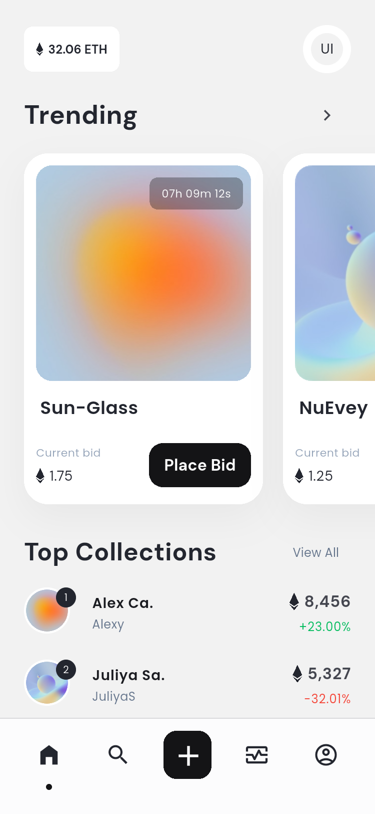

# DiveSea · Flutter NFT Market

根据 Pixso「DiveSea - NFT Market App UI KIT」开发的 Flutter App，覆盖 30 个参考界面及状态，包含可操作的市场浏览、搜索、收藏、关注、竞价、图片上传和个人资料流程。

这是离线可运行的本地交互演示，钱包、账户与交易尚未接入真实服务。

## 界面预览

下方为 Android 模拟器中的 App 实际截图。

| 推荐首页 | Trending | 作品详情 |
| --- | --- | --- |
|  |  |  |

| 竞价 | 搜索 | 个人中心 |
| --- | --- | --- |
|  |  |  |

## 文档与交付

- [项目结构与架构说明](docs/ARCHITECTURE.md)：分层结构、数据流、路由、设计规范与扩展边界。
- [全部界面清单](docs/SCREENS.md)：30 个 Pixso 画板与 App 截图逐一对应。
- [测试与运行记录](docs/TESTING.md)：检查结果、模拟器环境和截图复现步骤。
- `docs/design/`：Pixso 原稿截图及画板编号。
- `docs/screenshots/`：30 张 App 实际运行截图。
- `dist/`：Android 安装包。

## 运行

验证环境：Flutter 3.47.7、Dart 3.13.5、Android 15 / API 35。先安装 Flutter 与 Android SDK 并启动模拟器。

```sh
flutter pub get
flutter run -d emulator-5554
```

首次启动显示四步引导，之后可选择演示钱包或直接继续注册。注册 / 登录使用任意有效邮箱和至少 8 位密码；密码只用于表单校验，不会存储。可在首页标题点击切换推荐与 Trending 视图，底部中央加号进入作品创建，右上头像进入账户菜单。

## 结构概览

```text
lib/
  main.dart                  初始化
  app.dart                   启动分流与路由
  core/                      主题、共用组件、图片选择
  domain/                    数据模型与演示样本
  data/                      本地仓库
  state/                     共享状态与竞价规则
  features/                  按功能划分的页面
```

页面 → AppState → DemoRepository；通过 Flutter 原生 ChangeNotifier / InheritedNotifier 更新 UI。运行时仅使用 `shared_preferences` 和 `image_picker` 两个第三方依赖。

## 检查与构建

```sh
flutter analyze
flutter test
flutter build apk --release --split-per-abi
```

截图与端到端验证命令详见 [TESTING.md](docs/TESTING.md)。Android 已实际构建并运行；iOS 工程已准备，需在 macOS 上使用 Xcode 编译。交付 APK 使用开发签名，正式发布前应换用自己的签名配置。

## 功能边界

关注、收藏、头像 / 封面、个人资料、上传作品和模拟竞价均保存到当前设备。竞价会校验最低出价和余额，并更新历史与通知。作品图片来自系统相册，限制 10 MB，发布到本机收藏。

尚未连接服务器认证、真实钱包签名、链上合约、支付服务及第三方社交登录。OpenSea / Etherscan 等入口会说明演示项目没有真实合约；邀请奖励仅为原稿文案。图片快照存储适合少量演示，生产环境应替换为数据库与对象存储。
