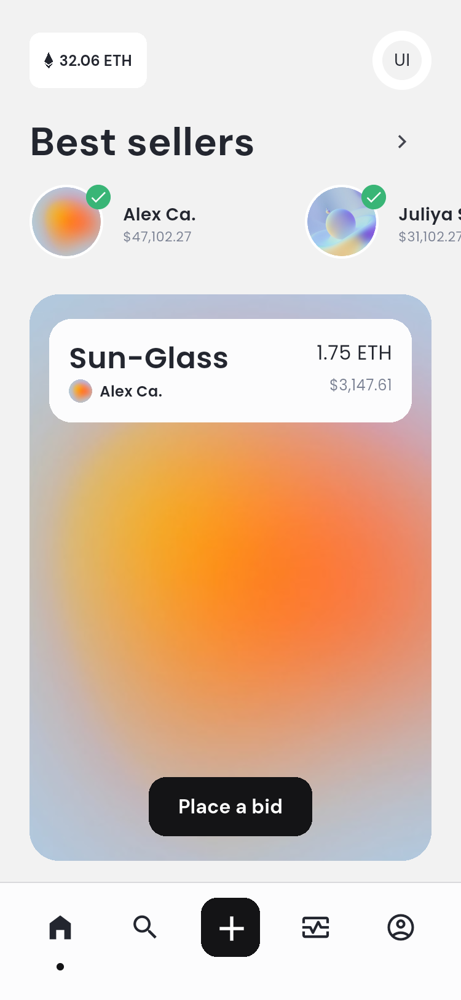
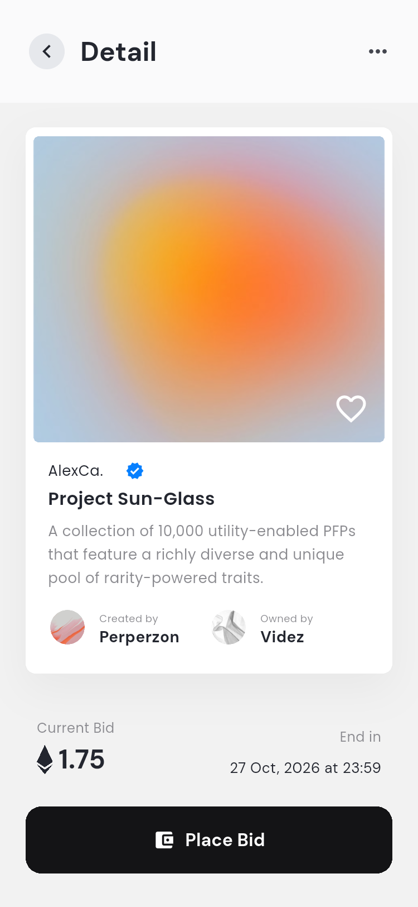
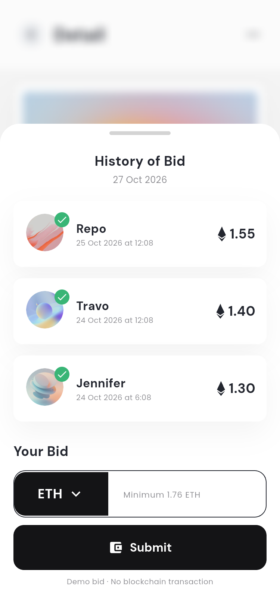
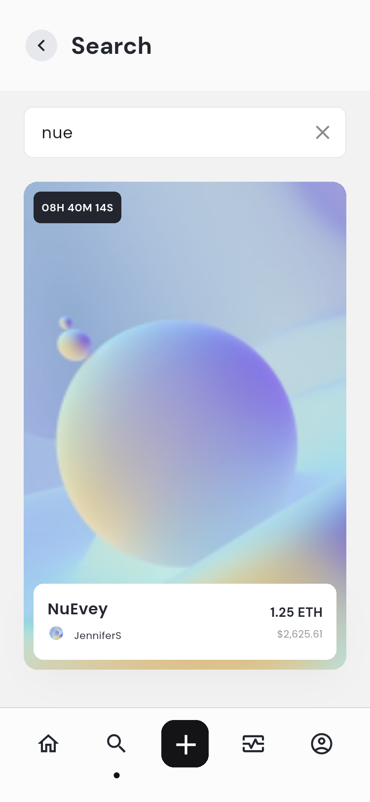
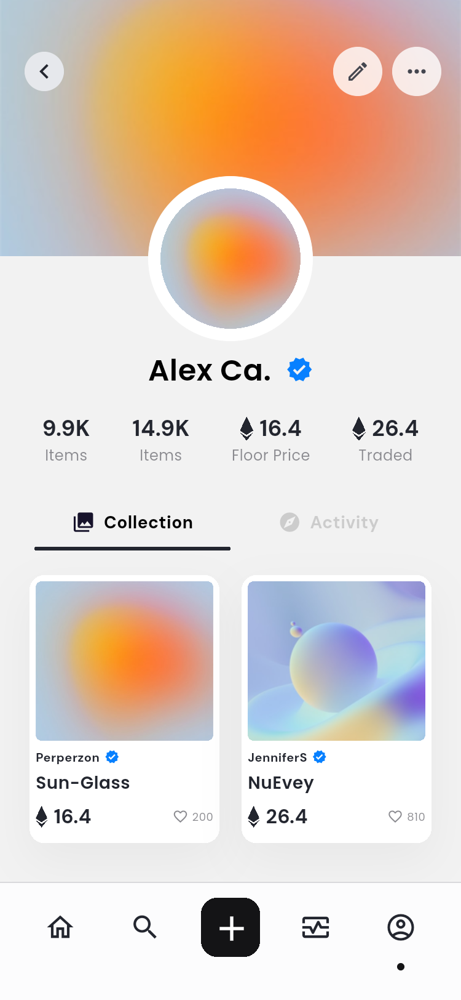
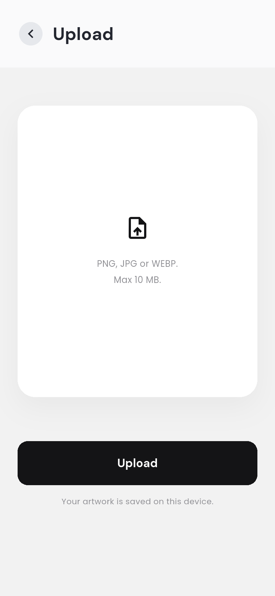
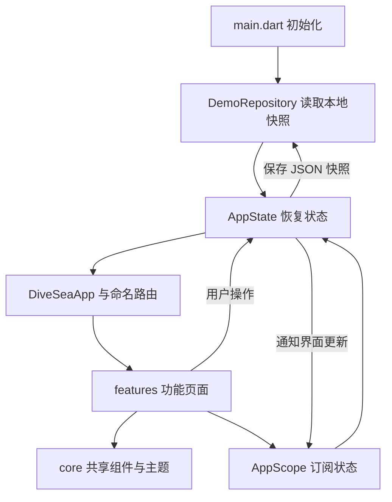

# DiveSea 项目结构与架构说明

## 1. 项目定位

DiveSea 是根据 Pixso 文件 **DiveSea - NFT Market App UI KIT** 实现的 Flutter NFT 市场交互演示 App。以 `Main App` 页面的 30 个画板为验收基准；`DiveSea App` 页面是相同界面的另一组排版，未重复实现。原设计编号没有 26，因此截图编号保留 25 → 27 的跳号。

本项目实现真实的 Flutter 布局、可操作表单、导航、图片选择和本地状态保存，没有把整张原稿当作页面背景。引导插画、NFT 作品及卖家头像从用户的 Pixso 文件导出；文字、卡片、输入框、按钮、弹层和导航栏均为 Flutter 组件。

当前交付范围是 **UI 与本地演示逻辑**。账户表单不创建服务器账户；钱包不会请求签名；竞价不会发起链上交易；作品发布保存在本机。Google / Facebook、OpenSea / Etherscan、密码修改、邀请奖励等需要服务端或第三方配置的入口会解释当前演示状态，不会伪造成功结果。

## 2. 主要页面

| 市场首页 | 作品详情 | 竞价弹层 |
| --- | --- | --- |
|  |  |  |

| 搜索结果 | 个人收藏 | 上传作品 |
| --- | --- | --- |
|  |  |  |

这些图片为 Android 模拟器运行截图，完整目录及原稿对照见 [界面清单](SCREENS.md)。

## 3. 目录结构

```text
DiveSeaNFTMarket/
├── lib/
│   ├── main.dart                    # 初始化 Flutter、本地仓库、全屏模式
│   ├── app.dart                     # 应用入口、命名路由、启动分流
│   ├── core/
│   │   ├── theme.dart               # 颜色、字体、表单与提示主题
│   │   ├── widgets.dart             # 按钮、头像、作品图片、底部导航、弹层
│   │   └── media.dart               # 统一相册选择、尺寸与大小限制
│   ├── domain/
│   │   └── models.dart              # Nft、Seller、Bid、MarketNotice 及演示数据
│   ├── data/
│   │   └── demo_repository.dart     # SharedPreferences 本地快照
│   ├── state/
│   │   └── app_state.dart           # 账户、钱包、收藏、关注、竞价、作品状态
│   └── features/
│       ├── onboarding/              # 四步引导
│       ├── wallet/                  # 钱包选择、连接弹窗、地址输入
│       ├── auth/                    # 注册、登录、输入校验
│       ├── market/                  # 两种首页、卖家榜、作品预览、详情与竞价
│       ├── discover/                # 搜索、结果与空态
│       ├── activity/                # 通知、加载态与空态
│       ├── create/                  # 单个 / 多版本作品上传
│       └── profile/                 # 收藏、活动、选项、资料编辑、设置
├── assets/
│   ├── images/                      # Pixso 导出的独立图片素材
│   └── fonts/                       # DM Sans、Poppins 及 OFL 许可证
├── android/                         # Android 原生宿主
├── ios/                             # iOS 原生宿主及相册用途说明
├── web/                             # Flutter Web 宿主
├── test/
│   ├── app_state_test.dart          # 竞价校验、余额、本地恢复等状态测试
│   └── screens_test.dart            # 18 个页面 × 3 种尺寸的布局测试
├── integration_test/app_test.dart   # 30 个状态截图与端到端流程
├── test_driver/integration_driver.dart # 将设备截图保存到 docs/screenshots
├── docs/
│   ├── ARCHITECTURE.md              # 本说明文档
│   ├── SCREENS.md                   # 原稿 / 实现对应表
│   ├── TESTING.md                   # 验证环境、结果与复现方式
│   ├── design/                     # 30 张原稿、画板 ID 清单
│   └── screenshots/                # 30 张 App 运行截图
├── dist/                            # 可安装 Android 包
├── pubspec.yaml
└── README.md
```

## 4. 架构与数据流

采用按功能划分的轻量分层结构。页面负责展示和临时交互，`AppState` 负责共享业务状态，`DemoRepository` 负责本地读写。通过 Flutter 原生 `ChangeNotifier` 和 `InheritedNotifier` 更新界面。



没有为每个页面创建控制器、仓库和服务的多层转发，也没有引入额外状态管理或路由库。两个运行时第三方依赖为 `shared_preferences`、`image_picker`，其余使用 Flutter SDK。

### 各层职责

| 层 | 职责 | 约束 |
| --- | --- | --- |
| `features` | UI、表单校验、弹窗、局部选择状态 | 不直接读写本地存储 |
| `state` | 账户、收藏、竞价规则及共享状态 | 不依赖页面控件 |
| `domain` | 作品、卖家、竞价、通知的数据结构 | 不依赖路由 |
| `data` | 序列化与本地快照 | 不操作 Navigator |
| `core` | 设计规范和复用组件、相册边界 | 不承载具体业务流程 |

### 状态的生命周期

- **持久状态**：引导完成状态、登录演示状态、姓名、邮箱、头像、封面、钱包选择、模拟余额、关注、收藏、竞价记录、通知和上传作品。
- **页面局部状态**：引导步骤、首页视图、搜索关键词、个人页选项卡、密码可见性、校验错误和提交中状态。
- **不保存**：输入的密码、第三方令牌、私钥、助记词或支付卡号。

启动时，已登录进入首页，已完成引导但未登录进入登录页，首次启动进入引导页。

## 5. 页面与路由

| 路由 | 页面 / 状态 |
| --- | --- |
| `/onboarding?step=0…3` | 引导 1–4 |
| `/wallet` | 选择钱包 |
| `/wallet?prompt=true` | 钱包连接弹窗 |
| `/wallet?return=true` | 从业务页进入钱包，完成后返回 |
| `/register`、`/login` | 注册、登录 |
| `?filled=true` | 表单示例填写状态，用于原稿对照 |
| `/home` | 推荐首页 |
| `/home?view=trending` | Trending 首页 |
| `/home?add=true` | 首页与创建类型弹层 |
| `/sellers` | 卖家榜 |
| `/product?id=sun` | 沉浸式作品预览 |
| `/detail?id=sun` | 作品详情 |
| `/detail?id=sun&sheet=menu` | 竞价选项菜单 |
| `/detail?id=sun&sheet=bid` | 竞价历史与出价表单 |
| `/search`、`/search?q=nue` | 搜索空态、搜索结果 |
| `/notifications` | 完整通知列表 |
| `/notifications?loading=true` | 原稿加载状态预览 |
| `/notifications?empty=true` | 原稿无记录状态预览 |
| `/profile`、`/profile?tab=activity` | 收藏、活动 |
| `/profile?menu=cover`、`?menu=account` | 封面菜单、账户菜单 |
| `/profile?favorites=true` | 实际收藏列表 |
| `/upload`、`/upload?multiple=true` | 单个、编号版本上传 |
| `/edit-profile`、`/settings` | 编辑资料、设置 |

这些是应用内部命名路由。`divesea://` 分享文本仅为演示标识，未注册 Android App Links 或 iOS Universal Links。

## 6. 主要交互规则

### 搜索与收藏

搜索按作品名或作者名匹配，忽略大小写，包含新上传的作品。输入为空显示发现提示，无结果显示空态。作品详情的爱心按钮会保存收藏状态，账户菜单中的 Favorite 展示实际收藏。

### 竞价

金额必须是有限数字，至少比当前最高价高 `0.01 ETH`，并且不超过可用演示余额。首次出价保留对应金额，同一使用者再次提高出价只保留差额；归属使用持久标记，不因修改昵称而丢失。成功后同步更新作品价格、历史、通知和余额。

这里的 ETH 是模拟数值；生产链上金额应换为整数最小单位或定点数，交易状态应由真实服务及链上回执驱动。

### 上传与资料图片

图片统一通过系统相册选择。作品和封面缩放至最长 1600 像素，头像缩放至最长 512 像素；单张图片限制为 10 MB。选择后可填写名称、起拍价；多版本模式额外要求 2–100 个版本。发布后本地个人收藏立即可见。

原稿标注的 1 GB 文件及音视频上传改为本地演示可支持的图片范围，页面说明也同步调整。图片取消选择不改变现有内容，无法读取时显示提示。

### 设置与资料

姓名、邮箱、头像和封面可修改并持久化。Share / Invite 复制可读文本到剪贴板。移除封面可恢复默认留白，再次替换可以选择新图片。退出登录清除登录与钱包连接状态，保留本机收藏和作品。

## 7. 视觉规范与适配

- 设计基准：375 × 812 逻辑像素。
- 背景 `#F2F2F2`，文字 `#23262F`，主要按钮 `#141416`，辅助文字 `#8A8A8F`。
- 标题与按钮使用 DM Sans，正文与卡片使用 Poppins；字体随应用打包，离线可用。
- 保留大幅 NFT 图片、圆角卡片、白色底部导航、雾化背景弹层和蓝色认证标记。
- 底部导航固定，其余长内容可滚动；键盘出现时表单和竞价弹层可滚动。
- 页面检查覆盖 320 × 640、375 × 812、480 × 900；更宽窗口中内容最大宽度为 480。
- 原稿中的拼写错误、旧日期、不可见按钮等按可用交互修正；使用 Material 语义图标近似原稿线性图标，并补充关闭、菜单、提示文字。

DM Sans 使用固定字重字体文件，避免本机 Windows Flutter 测试引擎处理可变字体时出现崩溃。原始字体与导出图片的来源及许可证见 `assets/fonts/*-OFL.txt` 和 `docs/design/screens.json`。

## 8. 扩展到真实产品

当前快照存储适合少量演示作品，不适合作为大量高清素材库。后续可保持页面和领域模型，替换 `DemoRepository` 为 API 与数据库实现，图片改为文件 / 对象存储；认证接入服务器会话；钱包接入 WalletConnect 等连接器；交易接入合约、手续费估算、签名和回执处理。

当前 Android release 包使用开发签名，方便直接安装验收。正式发布需要自己的签名密钥、账户体系、后端和隐私配置。iOS 已提供工程与相册用途声明，Windows 环境未执行 Xcode 编译或签名验证。

## 9. 代码精简

注册与登录共用一个表单页面；首页两种布局共用数据；详情、竞价历史与提交复用业务状态；个人收藏与活动共用个人页。按钮、头像、作品图片、价格、页面头部、弹层和图片选择抽成小型共用组件。已移除模板计数器和未使用的图标依赖，并统一格式化及静态检查。
