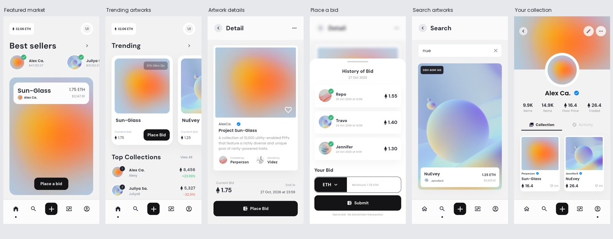

# 界面清单与截图对照

Pixso 文件：**DiveSea - NFT Market App UI KIT**，参考页面 `Main App (0:1)`。共 30 个画板，原稿未包含编号 26。

原稿尺寸为 375 × 812；App 在 Android 15 模拟器上以相同逻辑尺寸运行，截图为 750 × 1624。下表原稿链接来自 Pixso 导出，App 截图来自 Flutter 集成测试实际渲染。

## 主要界面总览

## 逐页对照

| 编号 | 界面 | Pixso 画板 ID | 应用路由 | 原稿 | App 截图 |
| --- | --- | --- | --- | --- | --- |
| 1 | 引导 1 | `3:4975` | `/onboarding?step=0` | [查看](design/1-onboarding-01.png) | [查看](screenshots/1-onboarding-01.png) |
| 2 | 引导 2 | `6:4925` | `/onboarding?step=1` | [查看](design/2-onboarding-02.png) | [查看](screenshots/2-onboarding-02.png) |
| 3 | 引导 3 | `6:4948` | `/onboarding?step=2` | [查看](design/3-onboarding-03.png) | [查看](screenshots/3-onboarding-03.png) |
| 4 | 开始使用 | `6:4991` | `/onboarding?step=3` | [查看](design/4-get-started.png) | [查看](screenshots/4-get-started.png) |
| 5 | 选择钱包 | `6:5056` | `/wallet` | [查看](design/5-choose-wallet.png) | [查看](screenshots/5-choose-wallet.png) |
| 6 | 钱包连接弹窗 | `6:5191` | `/wallet?prompt=true` | [查看](design/6-open-wallet.png) | [查看](screenshots/6-open-wallet.png) |
| 7 | 注册表单 | `8:13112` | `/register` | [查看](design/7-create-account.png) | [查看](screenshots/7-create-account.png) |
| 8 | 注册填写状态 | `8:13232` | `/register?filled=true` | [查看](design/8-create-account-active.png) | [查看](screenshots/8-create-account-active.png) |
| 9 | 登录表单 | `8:13340` | `/login` | [查看](design/9-login-account.png) | [查看](screenshots/9-login-account.png) |
| 10 | 登录填写状态 | `8:13479` | `/login?filled=true` | [查看](design/10-login-account-active.png) | [查看](screenshots/10-login-account-active.png) |
| 11 | 推荐首页 | `8:5040` | `/home` | [查看](design/11-home.png) | [查看](screenshots/11-home.png) |
| 12 | Trending 首页 | `8:5500` | `/home?view=trending` | [查看](design/12-home-v2.png) | [查看](screenshots/12-home-v2.png) |
| 13 | 卖家榜 | `8:5673` | `/sellers` | [查看](design/13-best-sellers.png) | [查看](screenshots/13-best-sellers.png) |
| 14 | 全屏作品预览 | `8:5137` | `/product` | [查看](design/14-product.png) | [查看](screenshots/14-product.png) |
| 15 | 作品详情 | `8:6862` | `/detail` | [查看](design/15-detail.png) | [查看](screenshots/15-detail.png) |
| 16 | 竞价选项菜单 | `8:7258` | `/detail?sheet=menu` | [查看](design/16-bid.png) | [查看](screenshots/16-bid.png) |
| 17 | 竞价历史 / 提交 | `8:7079` | `/detail?sheet=bid` | [查看](design/17-place-bid.png) | [查看](screenshots/17-place-bid.png) |
| 18 | 搜索空态 | `8:7866` | `/search` | [查看](design/18-search.png) | [查看](screenshots/18-search.png) |
| 19 | 搜索结果 | `8:7714` | `/search?q=nue` | [查看](design/19-search-active.png) | [查看](screenshots/19-search-active.png) |
| 20 | 通知加载状态 | `8:8111` | `/notifications?loading=true` | [查看](design/20-notification.png) | [查看](screenshots/20-notification.png) |
| 21 | 通知列表 | `8:7969` | `/notifications` | [查看](design/21-notification.png) | [查看](screenshots/21-notification.png) |
| 22 | 无通知状态 | `8:8233` | `/notifications?empty=true` | [查看](design/22-no-recents.png) | [查看](screenshots/22-no-recents.png) |
| 23 | 个人收藏 | `8:11370` | `/profile` | [查看](design/23-profile-collection.png) | [查看](screenshots/23-profile-collection.png) |
| 24 | 个人活动 | `8:12049` | `/profile?tab=activity` | [查看](design/24-profile-activity.png) | [查看](screenshots/24-profile-activity.png) |
| 25 | 封面选项菜单 | `8:11891` | `/profile?menu=cover` | [查看](design/25-side-profile-options.png) | [查看](screenshots/25-side-profile-options.png) |
| 27 | 账户选项菜单 | `8:12827` | `/profile?menu=account` | [查看](design/27-side-profile-options-v2.png) | [查看](screenshots/27-side-profile-options-v2.png) |
| 28 | 创建类型选择 | `8:12455` | `/home?add=true` | [查看](design/28-add.png) | [查看](screenshots/28-add.png) |
| 29 | 上传作品 | `8:12653` | `/upload` | [查看](design/29-upload.png) | [查看](screenshots/29-upload.png) |
| 30 | 编辑资料 | `8:14174` | `/edit-profile` | [查看](design/30-edit-profile.png) | [查看](screenshots/30-edit-profile.png) |
| 31 | 设置 | `8:14508` | `/settings` | [查看](design/31-setting.png) | [查看](screenshots/31-setting.png) |

## 差异与说明

- 原稿的空白 / 填写状态共用同一个表单组件；头像、菜单、收藏和竞价按钮可实际操作。
- 原稿中的钱包跳转文案替换为明确的演示钱包提示，避免误导为真实资产连接。
- 竞价最低金额依据当前价格计算，修正原稿中低于当前价的示例占位值。
- 原稿通知及竞价中的历史日期替换为演示样本日期。价格与资产数量均为演示数据。
- 上传页改为当前实现支持的图片类型与 10 MB 限制，选择图片后补充作品名称、价格及版本数量表单。
- 个人资料编辑页预填当前用户资料；补充原稿中没有明确绘出的菜单、关闭和错误提示入口。
- `loading=true`、`empty=true` 和 `filled=true` 等参数用于直接复现原稿状态，正常使用中页面由输入与本地数据变化驱动。

